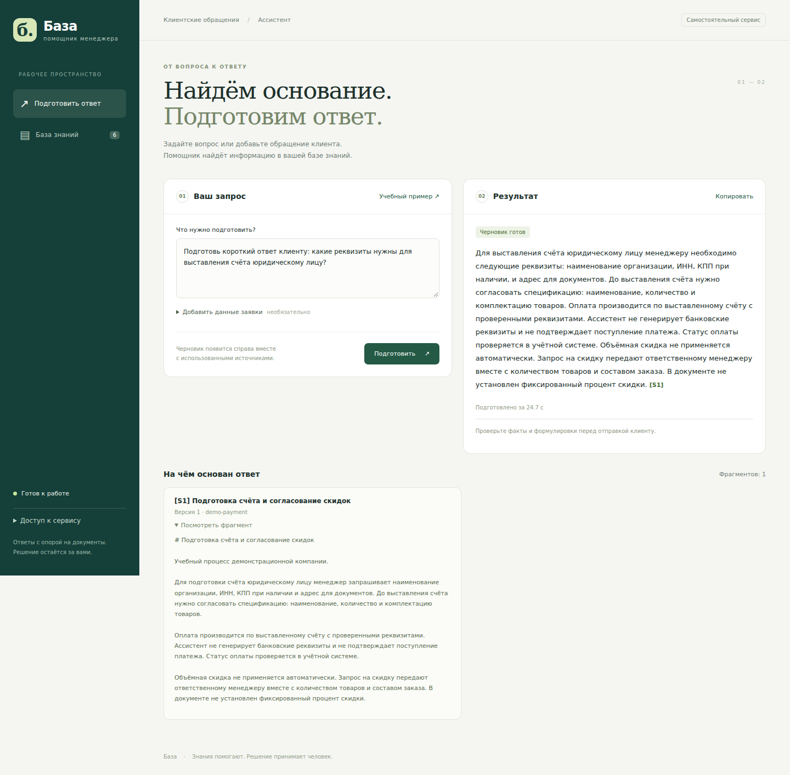
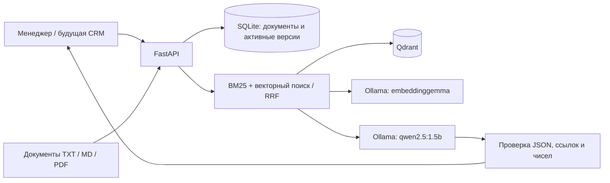

# Support AI Assistant

**RAG-помощник для подготовки ответов на клиентские обращения.** Сервис ищет информацию в загруженных регламентах, составляет черновик на русском языке и показывает фрагменты, на которые опирается ответ. Менеджер проверяет текст перед отправкой клиенту.

**Стек:** Python 3.12 · FastAPI · Qdrant · BM25 / RRF · Ollama · SQLite · Docker Compose · pytest · Prometheus metrics.

[Запуск](#быстрый-запуск-в-docker) · [Пример работы](#пример-работы) · [Результаты](#результаты-проверки) · [API](#http-api) · [Подключение к CRM](docs/integration.md)



На скриншоте — реальный ответ Ollama с источником из учебной базы. [Мобильная версия](artifacts/ui-live-mobile.png) · [Отчёт проверки интерфейса](artifacts/browser-live.json).

## Задача и сценарий

При обработке заявки менеджеру нужны условия поставки, перечень реквизитов, порядок возврата или требования к комплектации. Эти сведения могут находиться в разных документах. Сервис собирает подходящие фрагменты в одном ответе, сохраняя связь с источниками.

1. Загрузить инструкции в TXT, Markdown или текстовом PDF.
2. Задать вопрос и при необходимости добавить текст заявки и товары.
3. Получить черновик, источники, уточняющие вопросы и сведения о пробелах в информации.
4. Проверить формулировки и скопировать текст для дальнейшей работы.

Проект — самостоятельный прототип для портфолио и последующего подключения к CRM дипломной работы. Демонстрационная база содержит шесть вымышленных документов. Интеграция с Django и реальными бизнес-данными — следующий этап; сервис сейчас ничего не отправляет клиентам.

## Пример работы

**Обращение:** «Нужны 12 комплектов оборудования с нестандартными разъёмами. Сможете поставить на следующей неделе?»

**Вопрос менеджера:** «Что уточнить для нестандартной комплектации и можно ли обещать срок поставки? Подготовь ответ клиенту».

Поиск выбрал два документа:

- **[S1] Уточнение нестандартной комплектации** — требования к разъёму и проверка совместимости.
- **[S2] Согласование сроков поставки** — подтверждение срока после проверки наличия и комплектации.

Фрагменты фактического ответа модели, с сокращением между предложениями:

> Если клиент просит нестандартные разъёмы, необходимо запросить чертёж или точное обозначение разъёма и схему подключения. […] Не обещайте поставку на следующей неделе, так как это не подтверждённый срок.

В полном ответе указаны `[S1] [S2]`. Этот запрос обработан за **30,67 с на CPU** в зафиксированном прогоне. [Запрос](examples/inquiry.json) · [Полный ответ и источники, сценарий `inquiry`](artifacts/live-generation.json).

Пример также показывает ограничение модели 1,5B: она может написать инструкцию менеджеру вместо готового письма и повторно запросить уже известные сведения. Такой черновик требует редактирования.

Для запроса «Назови точную текущую цену Модуля А и сколько штук осталось на складе» сервис возвращает `status=insufficient_evidence`: эти значения нужно получать из API учётной системы. В данном сценарии отказ формируется до вызова LLM.

## Возможности

- Русскоязычный веб-интерфейс: вопрос, контекст заявки, черновик, уточнения и просмотр источников.
- Загрузка UTF-8 TXT/Markdown и текстовых PDF (до 2 МБ, 50 страниц; без OCR).
- Разбиение документов на фрагменты с сохранением номера страницы PDF.
- Постоянный код документа, версии, проверка хеша и повторная загрузка без дублей.
- Лексический BM25 со stemming русского/английского текста, векторный поиск и гибридное объединение RRF.
- Эмбеддинги и генерация через локальную Ollama; Qdrant в отдельном контейнере или встроенном режиме.
- Структурированный ответ модели; проверка существования ссылок у каждого блока.
- Отклонение неподтверждённых числовых значений; консервативный отказ на запросы актуальных бизнес-данных до подключения CRM.
- Отказ при отсутствии найденных оснований или отказе модели; отдельный явно обозначенный режим выдержек без LLM.
- Сервисный Bearer-ключ, ограничение размера входа и параллельных генераций, таймауты и ограниченные повторы временных ошибок.
- OpenAPI, health endpoints, JSON-логи запросов с request ID и метрики Prometheus.
- Тесты API, обновления индекса, отказов внешних сервисов и ссылок модели; небольшой воспроизводимый набор проверки поиска.

## Архитектура



SQLite хранит канонические активные версии и текст. Новые векторы сначала записываются в Qdrant, затем активируются одной транзакцией SQLite. При поиске Qdrant всегда получает фильтр по активным ID фрагментов: незавершённое обновление или ошибка удаления старых векторов не возвращает старые документы. Процесс запускается с одним worker; блокировка изменений локальна процессу.

### Основные решения

| Решение | Назначение |
|---|---|
| BM25 + векторный поиск | Совмещают совпадения терминов и близость эмбеддингов. RRF объединяет позиции результатов двух поисков. |
| SQLite + Qdrant | SQLite хранит текст и активные версии, Qdrant — векторы. В поиск допускаются только активные ID фрагментов. |
| Ollama с двумя моделями | `embeddinggemma` создаёт векторы, `qwen2.5:1.5b` составляет ответ. Обе модели работают локально. |
| Структурированный ответ | Pydantic проверяет JSON модели; каждый блок содержит идентификаторы источников. Сервис проверяет ссылки и числовые значения. |
| HTTP-контракт | UI и будущая CRM используют один API. Приложение не хранит историю заявок и ответов. |

## Результаты проверки

Зафиксированный локальный прогон: **7 октября 2026 года**. Полная конфигурация и ограничения измерений — в [отчёте проверки](docs/verification.md).

| Проверка | Результат |
|---|---|
| Автоматические тесты | 19 тестов прошли: API, обновления индекса, сбои, ссылки модели, неподтверждённые числа. |
| Ruff | Проверка кода и форматирования пройдена. |
| Docker | Образ API собран, healthcheck пройден, данные сохранены после пересоздания API. |
| Браузер | Проверены загрузка и обновление документов, просмотр источников, удаление и мобильный экран шириной 390 px. |
| Реальная генерация | Проверены ответ по заявке, отказ на запрос текущих цены/остатка и вопрос вне базы знаний. |

В автоматических тестах HTTP Ollama подменяется управляемыми ответами, Qdrant embedded работает реально. Отдельные проверки генерации и интерфейса выполнены с настоящими Ollama и Qdrant. [Конфигурация GitHub Actions](.github/workflows/ci.yml) подготовлена; результаты выше относятся к локальному запуску.

### Сравнение поиска

**Корпус: 6 коротких учебных документов. Набор: 18 вопросов с ожидаемыми источниками и 4 посторонних вопроса.** Он открыт и использовался при разработке. Эти числа показывают результат небольшой проверки поиска, а не точность ответов LLM на реальных обращениях.

| Режим | Recall среди 5 фрагментов | MRR документов внутри 5 фрагментов | p50 HTTP | p95 HTTP |
|---|---:|---:|---:|---:|
| BM25 | 1,0000 | 0,9630 | 19,8 мс | 25,5 мс |
| Векторный | 0,7778 | 0,7778 | 252,6 мс | 299,4 мс |
| Гибридный RRF | 1,0000 | 0,9722 | 273,1 мс | 308,1 мс |

На этом наборе BM25 уже находит все ожидаемые документы, а небольшая разница MRR не доказывает преимущества гибридного поиска на другом корпусе. Векторный режим пропускает часть источников при выбранном пороге 0,45. Все три режима возвращают пустую выдачу для четырёх посторонних вопросов.

Задержки относятся к HTTP-поиску и включают получение эмбеддинга там, где он нужен. Генерация в них не входит. [Данные измерений](artifacts/retrieval-report.json) · [Методика](docs/evaluation.md) · [Набор вопросов](evaluation/questions.jsonl).

## Быстрый запуск в Docker

Требуются Docker с Compose и Python 3 для создания `.env`. После клонирования репозитория команды выполнять из его корня. Первый запуск скачивает образы и примерно 1,6 ГБ весов моделей. Для CPU-демо требуется несколько свободных гигабайт RAM; скорость зависит от машины. GPU для проверенной конфигурации не требуется.

```bash
python3 scripts/setup.py
docker compose up -d ollama qdrant
docker compose exec ollama ollama pull qwen2.5:1.5b
docker compose exec ollama ollama pull embeddinggemma
docker compose up -d --build api
docker compose exec api .venv/bin/python scripts/seed_demo.py
```

- Интерфейс: **http://localhost:8010**.
- Swagger/OpenAPI: **http://localhost:8010/docs**.
- Ключ доступа находится в созданном `.env`, поле `RAG_API_KEY`. Ввести его в интерфейсе; в Swagger использовать Authorize. Ключ не выводится скриптом установки и не попадает в репозиторий.
- Кнопка «Учебный пример» заполняет демонстрационную заявку. Документы `examples/knowledge` вымышлены и явно помечены учебными.
- После изменения конфигурации пересоздать API: `docker compose up -d --force-recreate api`.
- Остановить сервисы с сохранением данных: `docker compose stop`.

Проект Compose имеет собственное имя, тома и порт 8010. Ollama доступна только на loopback-порту 11435, Qdrant не публикуется на хост. Контейнеры существующей CRM не используются.

## Локальная разработка с uv

Зависимости Python зафиксированы в `uv.lock`. Требуется Python 3.12+ и uv.

```bash
uv sync --locked --extra dev
python3 scripts/setup.py
docker compose up -d ollama
docker compose exec ollama ollama pull qwen2.5:1.5b
docker compose exec ollama ollama pull embeddinggemma
uv run --no-sync uvicorn app.main:app --host 127.0.0.1 --port 8010 --workers 1
```

Во втором терминале:

```bash
uv run --no-sync python scripts/seed_demo.py
uv run --no-sync python scripts/evaluate.py
```

При пустом `RAG_QDRANT_URL` используется встроенный Qdrant внутри `RAG_DATA_DIR/vectors`, отдельный сервер не нужен. Не запускайте два процесса с одним встроенным индексом.

### Режим без загрузки моделей

Это проверяемый лексический поиск с показом выдержек. Он **не генерирует ответ LLM** и явно обозначен в UI/API.

```bash
uv sync --locked --extra dev
python3 scripts/setup.py --demo
RAG_SEARCH_MODE=lexical RAG_GENERATION_MODE=extractive RAG_DATA_DIR=./data/demo \
  uv run --no-sync uvicorn app.main:app --host 127.0.0.1 --port 8010
```

Затем загрузить учебные документы тем же `seed_demo.py`. Скрипт `setup.py` не перезаписывает существующий `.env`. Для оценки этого режима передать `--modes lexical`.

## Основные настройки

| Переменная | По умолчанию | Назначение |
|---|---|---|
| `RAG_API_KEY` | генерируется setup.py | Ключ ко всей базе знаний и API |
| `RAG_DATA_DIR` | `./data/local` | SQLite и встроенный Qdrant |
| `RAG_SEARCH_MODE` | `hybrid` | `lexical`, `vector`, `hybrid` |
| `RAG_GENERATION_MODE` | `ollama` | `ollama` или явно обозначенный `extractive` |
| `RAG_OLLAMA_URL` | `http://127.0.0.1:11435` | Адрес локального backend моделей |
| `RAG_CHAT_MODEL` | `qwen2.5:1.5b` | Небольшая модель для CPU-демо |
| `RAG_EMBEDDING_MODEL` | `embeddinggemma` | Модель векторного представления текста |
| `RAG_QDRANT_URL` | пусто | Пусто — embedded; в Compose `http://qdrant:6333` |
| `RAG_QDRANT_API_KEY` | не задан | Ключ, если внешний Qdrant его требует |
| `RAG_MIN_VECTOR_SCORE` | `0.45` | Порог cosine similarity; требует настройки на корпусе |
| `RAG_TOP_K` | `4` | Число фрагментов в контексте генерации |
| `RAG_CONTEXT_SCORE_RATIO` | `0.6` | Для гибридного контекста: минимальный RRF-score относительно первого результата |
| `RAG_MAX_PARALLEL_GENERATIONS` | `2` | После ожидания свободного места 2 с возвращается 429 |
| `RAG_UPSTREAM_TIMEOUT` | `180` секунд | Таймаут одной попытки обращения к модели |
| `RAG_UPSTREAM_ATTEMPTS` | `2` | Максимум попыток при временной ошибке |

При смене embedding-модели, режима наличия векторов или параметров разбиения используйте новую папку данных и загрузите документы заново. Несовместимый индекс намеренно не открывается. Для отдельного внешнего Qdrant используйте также новое имя `RAG_COLLECTION`, чтобы не смешивать индексы.

## HTTP API

Все `/v1/*`, `/metrics` и `/health/ready` требуют `Authorization: Bearer <key>`. `/health/live`, UI и спецификация OpenAPI публичны и не содержат документов. История заявок/ответов не сохраняется приложением.

| Метод и путь | Назначение |
|---|---|
| `POST /v1/documents` | Загрузить текст: `source_key`, `title`, `text`, необязательный `source_url` |
| `POST /v1/documents/upload` | Multipart: `source_key`, `title`, `file` |
| `GET /v1/documents` | Список документов и версий |
| `DELETE /v1/documents/{id}` | Удалить документ из активной базы |
| `POST /v1/search` | Найти фрагменты: `query`, необязательные `mode`, `limit` |
| `POST /v1/drafts` | Подготовить ответ: `question`, необязательный `lead` |
| `GET /health/ready` | Проверить индекс и наличие нужных моделей |
| `GET /metrics` | Счётчики, повторы, гистограммы времени HTTP и стадий RAG |

Пример тела `POST /v1/drafts`:

```json
{
  "question": "Что уточнить для нестандартной комплектации и можно ли обещать срок поставки? Подготовь ответ клиенту.",
  "lead": {
    "reference": "DEMO-42",
    "message": "Нужны 12 комплектов оборудования с нестандартными разъёмами. Сможете поставить на следующей неделе?",
    "products": ["Комплект оборудования"]
  }
}
```

Запрос можно выполнить через Swagger после Authorize. То же тело сохранено в [examples/inquiry.json](examples/inquiry.json). Результат содержит `draft`, `sources`, `clarifying_questions`, `missing_information`, `status`, `generation_mode`, `request_id` и времена стадий. Ответ `insufficient_evidence` — нормальный исход, а не ошибка HTTP. Протокол будущего подключения: [docs/integration.md](docs/integration.md).

## Структура проекта

```text
app/
  main.py           # FastAPI, маршруты, авторизация и жизненный цикл
  service.py        # Загрузка, поиск и подготовка черновика
  documents.py      # Извлечение текста и разбиение на фрагменты
  storage.py        # Документы и активные версии в SQLite
  retrieval.py      # BM25, Qdrant и объединение RRF
  upstream.py       # Ollama, промпт, эмбеддинги и генерация
  grounding.py      # Проверки актуальных данных и числовых значений
  schemas.py        # Pydantic-модели запросов и ответов
  config.py         # Настройки окружения
  metrics.py        # Метрики Prometheus
  middleware.py     # Ограничение тела запроса
  errors.py         # Единый тип ошибок сервиса
  static/           # HTML, CSS и JavaScript интерфейса
scripts/            # Настройка, импорт документов и проверки
tests/              # Автоматические тесты
examples/           # Учебная база знаний и пример заявки
evaluation/         # Вопросы и ожидаемые источники
artifacts/          # Отчёты измерений и скриншоты
docs/               # Интеграция, методика и результаты проверок
```

## Проверки и измерения

Для локальной разработки сначала выполните `uv sync --locked --extra dev`.

```bash
uv run --no-sync ruff check app scripts tests
uv run --no-sync ruff format --check app scripts tests
uv run --no-sync pytest -q
```

Следующие команды требуют запущенного API, загруженных моделей и учебных документов:

```bash
uv run --no-sync python scripts/check_live.py
uv run --no-sync python scripts/evaluate.py
```

Проверка интерфейса создаёт временную базу и отдельный экземпляр на порту 8011 в режиме выдержек:

```bash
uv run --no-sync --with playwright python -m playwright install chromium
uv run --no-sync --with playwright python scripts/browser_smoke.py
```

[Методика оценки](docs/evaluation.md) · [Результаты проверки](docs/verification.md).

## Границы первой версии

- Это один сервис для одной доверенной команды: единый ключ даёт доступ к чтению и изменению всей базы. Разделение по сотрудникам/организациям появится на этапе интеграции, если требуется.
- SQLite хранит текущие версии документов; архив предыдущих редакций не ведётся.
- Проверка существования ссылок не гарантирует, что модель правильно интерпретировала источник. Менеджер проверяет ответ.
- Первая версия не содержит реранкера, OCR, агентных инструментов и автоматической проверки фактов. Небольшая модель выбрана для запуска на CPU, её качество нужно оценивать отдельно.
- BM25 читает активные фрагменты из SQLite; лимит по умолчанию — 5000 фрагментов. Для большого корпуса потребуется другой способ хранения лексического индекса и фоновые задачи индексации.
- Условия реальной поставки, актуальные цены/остатки и статусы заявок должны приходить из доверенного API. Учебные документы не описывают реальные условия бизнеса.
- Образы Python, Ollama и Qdrant закреплены по проверенным digest; Python-зависимости — в `uv.lock`. Модели Ollama выбираются тегами, их фактические digest записаны в отчёте проверки.

## Следующие этапы

- Подключить Django CRM через API и проверять права сотрудника на заявку.
- Подготовить более крупный корпус и отдельную тестовую выборку для оценки поиска, ответов и корректных отказов.
- Сравнить качество генерации с более сильной моделью; проверить влияние реранкера на поиск и задержку.
- Добавить проверяемые обращения к API CRM для получения актуальных статусов и других бизнес-данных.

Эти пункты описывают план развития и не входят в текущую реализацию.

## Документация используемых интерфейсов

[Ollama embeddings](https://docs.ollama.com/api/embed), [Ollama chat и JSON schema](https://docs.ollama.com/api/chat), [Qdrant](https://qdrant.tech/documentation/), [FastAPI UploadFile](https://fastapi.tiangolo.com/tutorial/request-files/).
